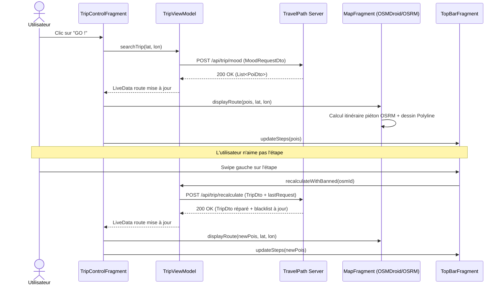

# 📱 TravelPath — Client (Application Mobile Android)


> **Application mobile Android native** de découverte d'itinéraires personnalisés en temps réel. Basée sur **OpenStreetMap (`osmdroid`)** et le routage piéton **OSRM**, elle communique avec le backend **TravelPath Server** pour générer des parcours adaptés au profil de l'utilisateur et permet d'exclure/remplacer dynamiquement chaque étape d'un simple glissement de doigt (*Swipe*).

---

## 📋 Table des matières

- [Fonctionnalités principales](#-fonctionnalités-principales)
- [Architecture logicielle](#-architecture-logicielle)
- [Diagrammes & Schémas](#-diagrammes--schémas)
  - [1. Architecture MVVM & Injection manuelle (`AppContainer`)](#1-architecture-mvvm--injection-manuelle-appcontainer)
  - [2. Séquence d'interaction : Génération & Swipe d'une étape](#2-séquence-dinteraction--génération--swipe-dune-étape)
  - [3. Architecture UI & Communication inter-fragments](#3-architecture-ui--communication-inter-fragments)
- [Structure du projet](#-structure-du-projet)
- [Configuration & Compilation](#-configuration--compilation)

---

## ✨ Fonctionnalités principales

- **Cartographie OpenStreetMap fluide (`MapFragment`)** : Rendu matériel via `osmdroid`, suivi GPS en temps réel (`MyLocationNewOverlay`), rotation tactile multi-touch, marqueurs personnalisés et tracé d'itinéraire piéton calculé en arrière-plan via **OSRM** (`OSRMRoadManager`).
- **Génération d'itinéraires en un clic (`GO !`)** : Acquisition de la position GPS (`FusedLocationProviderClient` avec fallback), chargement des préférences locales et appel asynchrone à l'API REST `/api/trip/mood`.
- **Édition interactive par Swipe (`TopBarFragment`)** :
  - Bandeau supérieur repliable affichant la prochaine étape ou la liste complète (`RecyclerView`).
  - **Synchronisation bidirectionnelle Carte ↔ Liste** : Cliquer sur une étape centre la caméra sur son marqueur ; cliquer sur un marqueur fait défiler la liste vers l'étape correspondante.
  - **Swipe-to-Ban (`ItemTouchHelper`)** : Glisser une étape vers la gauche ou la droite déclenche un appel à `/api/trip/recalculate` pour bannir ce lieu et le remplacer localement tout en conservant l'historique de la blacklist dans le `TripViewModel`.
- **Personnalisation avancée (`UserSettingsActivity`)** : Paramétrage du budget journalier (€), de la possession d'un véhicule (rayon de recherche passant automatiquement de **3 km** à **30 km**), de la densité des étapes (`spreadingScale`) et de 6 curseurs d'intérêts (*Culture, Nature, Food, Fun, Night Life, Shopping*) persistés dans `SharedPreferences`.
- **Sécurité anti-tampering (`SecurityDetector`)** : Vérification au démarrage de l'intégrité de l'environnement d'exécution (détection de débogueur, mode développeur, accès root `su` et émulateurs).

---

## 🏗️ Architecture logicielle

L'application suit une **architecture MVVM (Model-View-ViewModel)** couplée à une séparation stricte des couches **UI / Domain / Data** et un conteneur d'injection de dépendances manuel (`AppContainer`) :

| Couche | Packages clés | Responsabilités |
| :--- | :--- | :--- |
| **UI (`ui/`)** | `main`, `map`, `trip`, `settings` | `MainActivity` (médiateur entre fragments), `MapFragment` (OSMDroid/OSRM), `TopBarFragment` (liste & swipe), `TripControlFragment` (barre d'action), `TripViewModel` (`LiveData`). |
| **Domain (`domain/`)** | `model`, `repository`, `Utils` | Modèle immuable `PointOfInterest`, contrat `ITripRepository` et utilitaire GPS `LocationHelper`. |
| **Data (`Data/`)** | `Api`, `Local`, `Repository` | Client Retrofit (`TravelPathApi`) avec intercepteur `X-API-KEY`, mappers `FactoryDto`, implémentation `TripRepositoryImpl` et stockage local `UserPrefsManager`. |
| **DI & Sécurité** | `di`, `com.security.detector` | `AppContainer` (Singletons Retrofit, Repository, Prefs) et `SecurityDetector`. |

---

## 📊 Diagrammes & Schémas

### 1. Architecture MVVM & Injection manuelle (`AppContainer`)

```mermaid
flowchart TB
    subgraph App["TravelPathApplication"]
        DI["AppContainer (Singletons)<br/>• OkHttp + Retrofit (X-API-KEY)<br/>• TravelPathApi<br/>• TripRepositoryImpl<br/>• UserPrefsManager"]
    end

    subgraph UI["Couche Présentation (UI)"]
        MainAct["MainActivity<br/>(Médiateur & SecurityDetector)"]
        MapFrag["MapFragment<br/>(OSMDroid + OSRM)"]
        TopFrag["TopBarFragment<br/>(RecyclerView + Swipe)"]
        CtrlFrag["TripControlFragment<br/>(Bouton GO & Options)"]
        SettingsAct["UserSettingsActivity<br/>(Sliders & Budget)"]
        VM["TripViewModel<br/>(LiveData: route, isLoading, error)"]
    end

    subgraph Domain["Couche Domaine"]
        RepoIf["ITripRepository"]
        POI["PointOfInterest (Immuable)"]
        Loc["LocationHelper (GPS)"]
    end

    subgraph Data["Couche Données"]
        RepoImpl["TripRepositoryImpl"]
        Retrofit["TravelPathApi (Retrofit)"]
        Prefs["UserPrefsManager<br/>(SharedPreferences)"]
    end

    Backend(("🌐 TravelPath Server<br/>https://travelpath.delweb.fr"))

    DI -.->|Injecte via Factory| VM
    DI -.->|Injecte| SettingsAct
    MainAct --> MapFrag
    MainAct --> TopFrag
    MainAct --> CtrlFrag
    CtrlFrag --> VM
    CtrlFrag --> Loc
    SettingsAct --> Prefs
    VM --> RepoIf
    VM --> Prefs
    RepoIf <|.. RepoImpl
    RepoImpl --> Retrofit
    Retrofit <-->|REST JSON| Backend
    VM -->|LiveData&lt;List&lt;PointOfInterest&gt;&gt;| CtrlFrag
```

---

### 2. Séquence d'interaction : Génération & Swipe d'une étape



---

### 3. Architecture UI & Communication inter-fragments

```mermaid
flowchart LR
    Main["MainActivity<br/>(Implémente les 3 interfaces)"]
    
    Ctrl["TripControlFragment"] -->|MapUpdateListener.onRouteFound()| Main
    Main -->|displayRoute()| Map["MapFragment"]
    Main -->|updateSteps()| Top["TopBarFragment"]
    
    Top -->|OnStepActionListener.onStepClicked()| Main
    Main -->|focusOnStep(pos)| Map
    
    Map -->|OnMarkerClickListener.onMarkerClicked()| Main
    Main -->|scrollToStep(pos)| Top
    
    Top -->|OnStepActionListener.onStepSwiped(id)| Main
    Main -->|recalculateWithBanned(id)| Ctrl
```

---

## 📁 Structure du projet

```text
TravelPath_Client/
├── .gitlab-ci.yml                          # Pipeline CI GitLab (compilation APK debug)
├── build.gradle.kts & settings.gradle.kts  # Configuration Gradle (Repositories Maven & JitPack)
├── gradle/libs.versions.toml               # Catalogue centralisé des versions (AGP 8.13, AndroidX)
└── app/
    ├── build.gradle.kts                    # SDK 24..36, ViewBinding, OSMDroid, OSMBonusPack, Retrofit
    └── src/main/
        ├── AndroidManifest.xml             # Permissions GPS/Réseau & déclaration des Activities
        ├── java/
        │   ├── com/security/detector/
        │   │   └── SecurityDetector.java   # Détection Root, Émulateur, Debugger, Mode Développeur
        │   └── fr/um/ico/mobile/travelpath/
        │       ├── TravelPathApplication.java # Initialisation globale d'AppContainer
        │       ├── di/AppContainer.java    # Injection de dépendances & configuration OkHttp/Retrofit
        │       ├── Data/
        │       │   ├── Api/                # TravelPathApi & DTOs (MoodRequestDto, TripDto, PoiDto...)
        │       │   ├── Local/              # UserPrefsManager (SharedPreferences)
        │       │   └── Repository/         # TripRepositoryImpl
        │       ├── domain/
        │       │   ├── model/              # PointOfInterest
        │       │   ├── repository/         # ITripRepository
        │       │   └── Utils/              # LocationHelper (FusedLocationProviderClient)
        │       └── ui/
        │           ├── main/               # MainActivity & MainViewModelFactory
        │           ├── map/                # MapFragment (Carte OSMDroid & routage piéton OSRM)
        │           ├── settings/           # UserSettingsActivity (Préférences utilisateur)
        │           └── trip/               # TripViewModel, TopBarFragment, TripControlFragment, TripStepAdapter
        └── res/                            # Layouts XML (ViewBinding), icônes vectorielles & thèmes
```

---

## 🚀 Configuration & Compilation

### Prérequis
- **Android Studio** (Ladybug ou supérieur) avec **JDK 17+**
- **Android SDK** (`compileSdk = 36`, `minSdk = 24`)
- Un appareil Android physique recommandé pour les tests (remarque : `SecurityDetector` bloque par défaut l'exécution sur émulateur ou appareil rooté/en mode développeur).

### Endpoint Backend
L'URL de production du serveur est configurée dans `app/src/main/java/fr/um/ico/mobile/travelpath/di/AppContainer.java` :

```java
retrofit = new Retrofit.Builder()
        .baseUrl("https://travelpath.delweb.fr/")
        .client(client)
        .addConverterFactory(GsonConverterFactory.create())
        .build();
```

*(Pour pointer vers un serveur local lors du développement, remplacez cette URL par `http://10.0.2.2:8080/` ou l'adresse IP locale de votre machine).*

### Build via Gradle & CI/CD

```bash
# Compiler l'APK de debug en ligne de commande
chmod +x ./gradlew
./gradlew assembleDebug
```

L'APK généré est disponible sous `app/build/outputs/apk/debug/app-debug.apk`. Ce processus est également automatisé sur GitLab CI (`.gitlab-ci.yml`) à chaque commit sur la branche `master`.
